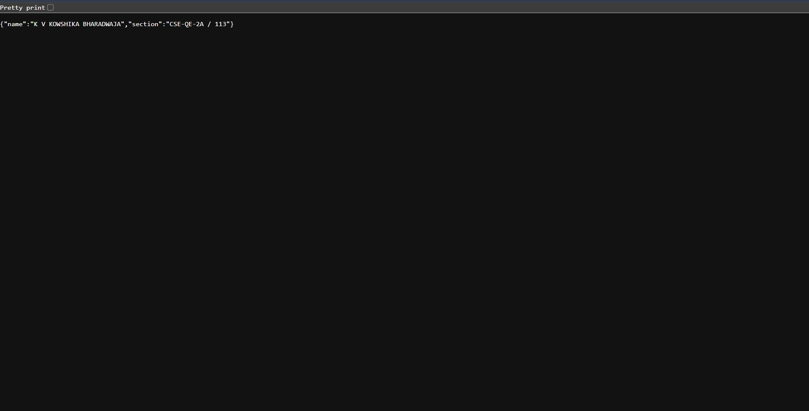

# Lab 1: Node.js and Express Server

## Student Details

- **Name:** K V KOWSHIKA BHARADWAJA
- **Registration Number:** [Enter your registration number]
- **Section:** CSE-QE-2A / 113

## Live Link

**Live Application:** https://nodejs-express-lab-01.onrender.com/

**GitHub Repository:** https://github.com/kaushik-113/nodejs-express-lab-01

## Objective

To create and deploy a basic web server using Node.js and Express.js. The application demonstrates routing, sending text responses, returning JSON data, displaying the current date and time, and handling invalid routes with an HTTP 404 status.

## Technologies Used

- Node.js
- Express.js
- JavaScript
- Git and GitHub
- Render (deployment platform)

## How to Run the Project

### Prerequisites

Install Node.js and npm on your computer.

### 1. Clone the repository

```bash
git clone https://github.com/kaushik-113/nodejs-express-lab-01.git
```

### 2. Navigate to the project directory

```bash
cd nodejs-express-lab-01
```

### 3. Install dependencies

```bash
npm install
```

### 4. Environment variables

The application uses the `PORT` environment variable when provided by the hosting platform. If it is not set, the server uses port `3000` by default.

No additional environment variables are required.

### 5. Start the server

```bash
npm start
```

The server starts at:

`http://localhost:3000`

Open the URL in a web browser to test the application locally.

## Endpoints Table

| Method | Endpoint | Description | Expected Response |
|---|---|---|---|
| GET | `/` | Home route | Welcome to my server! |
| GET | `/about` | Displays student details | JSON containing name and section |
| GET | `/time` | Displays current date and time | Date and time as text |
| GET | `/hello123` | Tests an invalid route | Page not found (HTTP 404) |

### Live Endpoint Links

- [Home](https://nodejs-express-lab-01.onrender.com/)
- [About](https://nodejs-express-lab-01.onrender.com/about)
- [Time](https://nodejs-express-lab-01.onrender.com/time)
- [404 Test](https://nodejs-express-lab-01.onrender.com/hello123)

## Screenshots

The following screenshots demonstrate the application running successfully.

### 1. Home Route


### 2. About Route



### 3. Time Route


### 4. 404 Error Handling


## Problems Faced and Solutions

### 1. Setting Up the Express Server

**Problem:** Configuring the application and starting the server correctly.

**Solution:** Installed Express.js, created the `app.js` file, configured the routes, and added `app.listen()` to start the server.

### 2. Configuring the Start Command

**Problem:** Making the application start using a simple npm command.

**Solution:** Configured the `start` script in `package.json` to run `node app.js`.

### 3. Handling Invalid Routes

**Problem:** Providing an appropriate response when a user requests a route that does not exist.

**Solution:** Added a fallback middleware that returns the message `Page not found` with HTTP status code `404`.

### 4. Deploying the Application

**Problem:** Making the application accessible through a public URL.

**Solution:** Pushed the project to GitHub and deployed it using Render. Configured the server to use `process.env.PORT || 3000` so that it works in both local and hosted environments.

### 5. Testing Live Links

**Problem:** Some live links displayed network errors or took time to load.

**Solution:** Tested the endpoints directly in the browser and checked the deployment status. Render's free hosting service may take time to wake up after inactivity.

## Conclusion

This lab helped me understand how to create a web server using Node.js and Express.js. I learned to configure routes, send text and JSON responses, work with date and time, handle invalid routes using HTTP status codes, use npm scripts, manage source code with Git and GitHub, and deploy a web application using Render.
